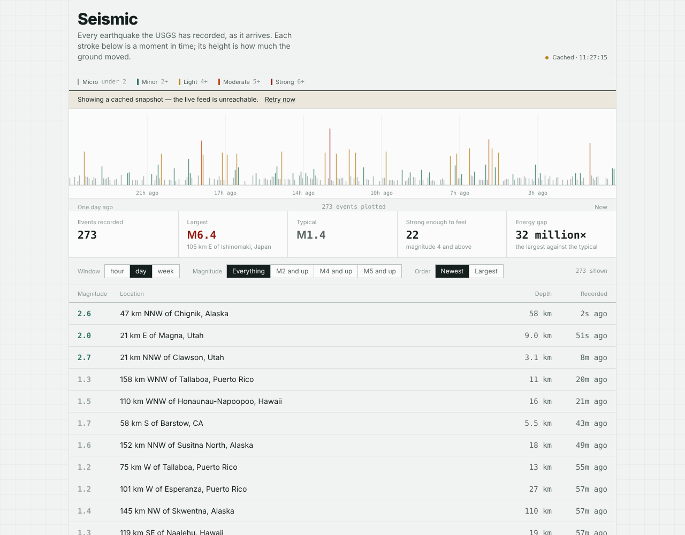

# Seismic

A live dashboard of every earthquake recorded by the USGS, plotted as a
seismogram-style trace.

**[Live demo](https://seismic.vercel.app)** · React 19 · TypeScript · Tailwind CSS 4 · Motion



## Why this exists

Most earthquake dashboards draw magnitude as if it were a linear quantity. It
isn't — the scale is logarithmic, and a magnitude 6 releases about a million
times the energy of a magnitude 2. This interface is built around that one fact:

- The hero is a **trace**, not a stat row. Each stroke is a column of time, its
  height the largest magnitude recorded in that column. Mostly small, with the
  occasional spike — which is what seismicity actually looks like.
- The readout states the **energy gap** between the largest event and a typical
  one, as a multiple. It is usually in the millions.
- Filtering by magnitude **dims** the rest of the trace instead of removing it,
  so narrowing to M5+ never hides how rare that is.

## Engineering notes

**One parse at the boundary.** `src/api/wire.ts` transcribes the published USGS
GeoJSON schema; `src/api/parse.ts` narrows `unknown` into the domain types in
`src/domain/quake.ts`. Nothing downstream imports the wire types, so a change at
the API surfaces in one file rather than across every component. Events that
fail validation are counted and surfaced in the UI instead of silently dropped.

**Errors are typed by what the user can do about them.** `FeedError` carries a
kind — `offline`, `timeout`, `server`, `malformed` — and each kind has its own
copy. "Something went wrong" tells a person nothing about whether to wait or go
and check the service.

**Degrading rather than failing.** If the live request fails on first load, a
generated snapshot is loaded through the same parser and the UI labels itself as
cached. The snapshot is dynamically imported, so its 1 MB of GeoJSON is a
separate chunk and never lands in the main bundle. Its magnitudes follow the
Gutenberg–Richter distribution with separate detection thresholds for regional
and teleseismic networks, because modelling a mixed catalogue as one
distribution is what makes synthetic seismicity look wrong.

**Rendering 1,800 events.** The trace buckets events into 3-pixel columns and
draws the peak of each, so the SVG stays at a few hundred nodes whatever the
window. The table renders incrementally.

**Refresh without flicker.** A background poll every 60 s sets `refreshing`
rather than `loading`, so the screen never blanks. In-flight requests are
aborted on window change, and the request timeout and caller cancellation are
separate `AbortController`s rather than one conflated signal.

## Running it

```bash
npm install
npm run dev          # http://localhost:5173
npm run build        # typecheck, then production build
npm run preview      # serve the build locally
```

Regenerate the offline snapshot with `node scripts/generate-snapshot.mjs`.
It uses a seeded PRNG, so the output is stable between runs.

## Accessibility

Keyboard-operable table rows and detail panel, focus returned on close, visible
focus rings, live regions on the result count, and `prefers-reduced-motion`
respected — the trace reveal and panel transition both collapse to no animation.
Magnitude is never signalled by colour alone; the number is always present.

## Data

[USGS Earthquake Hazards Program](https://earthquake.usgs.gov/earthquakes/feed/v1.0/geojson.php),
public domain, no API key required.
